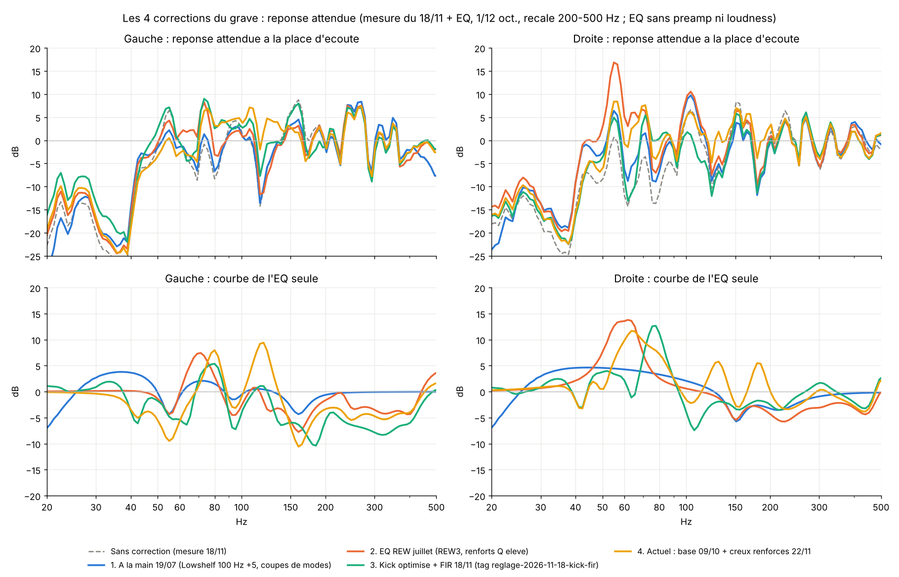

# Les 4 corrections du grave (archive et comparaison, 22/11/2026)

| # | Correction | Config complete | Origine |
|---|---|---|---|
| 1 | A la main, 19/07 : passe-haut 28 Hz, Lowshelf 100 Hz +5 dB, coupes de modes (G 55/93/160, D 151/215) | `configs/1-main-2026-07-19.yml` | `archive-pi/backup-juillet-2026/camilladspClaude.yml` |
| 2 | EQ auto REW de juillet (REW3, 20/07) : renforts a Q eleve (G 70,5 Hz +10 Q3, D 56 Hz +11 Q3,5, 64 Hz +8 Q6) | `configs/2-rew3-juillet-origine.yml` (tel quel), `configs/2-rew3-juillet-base-actuelle.yml` (sur la base actuelle, celle qu'on ecoute) | `camilladsp/rew-history/camilladspREW3.yml`, `test-juillet/` |
| 3 | Kick optimise + FIR de phase, 18/11 (optimisation automatique sur reponses impulsionnelles) | `configs/3-kick-fir-2026-11-18.yml` + `mesure/fir/phase_*.raw` | tag `reglage-2026-11-18-kick-fir` (9554bac) |
| 4 | Actuel : equilibrage du 09/10 + creux recurrents renforces (+8/+9 G, +8/+9/+10 D), 22/11 | `configs/4-actuel-creux-2026-11-22.yml` | `camilladsp/camilladsp-qobuz.yml` |

Courbes : `python3 correction/comparaison/compare4.py` (ecrit `compare4.png` et `compare4.json`).

Methode : mesure a la place d'ecoute du 18/11 (`mesure/resultats/ir/k0_origine`), correction de
l'epoque retiree, puis filtres de chaque correction appliques. Comptes : Peaking, Lowshelf/Highshelf,
passe-haut Butterworth, FIR. Non comptes : loudness (depend du volume), limiteur, gains constants.
Courbes recalees sur 200-500 Hz, moyenne 1/12 octave.

Limite : les corrections 1 et 2 ont ete faites en juillet a une autre place d'ecoute ; leur
prevision ici est celle qu'elles donnent a la place actuelle (d'ou le pic D 56 Hz a +17 dB de REW3).
