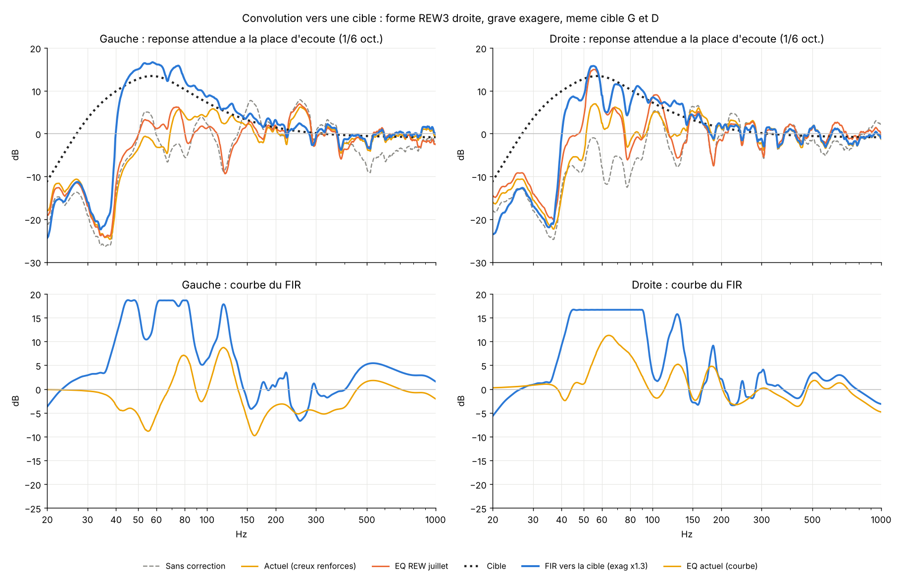

# Test : correction du grave par convolution vers une cible (22/11/2026)

Idee (Rulio12) : viser directement la reponse voulue et l'obtenir par un FIR, sans
filtres de correction apres l'etage de convolution. Cible inspiree de la reponse
droite avec l'EQ REW3 de juillet, appliquee aussi a gauche, avec une demande de grave
exageree, car les reflexions de la piece empechent un simple delta de tout rattraper.

## Construction (`cible_fir.py`)

- Mesure : place d'ecoute du 18/11 (`mesure/resultats/ir/k0_origine`), correction de l'epoque retiree, lissee 1/6 octave.
- Cible (0 dB = niveau 200-500 Hz) : bosse 58 Hz +11 dB Q0,8 + Lowshelf 110 Hz +4 dB + passe-haut 32 Hz ordre 4. Meme cible G et D.
  Le niveau 200-500 Hz de chaque voie reste celui du reglage actuel (equilibre G/D garde).
- Delta = cible - mesure. Boosts sous 150 Hz x 1,3 (`--exag`), plafond +15 dB (0 dB sous 36 Hz, rampe jusqu'a 44 Hz), coupes maxi -20 dB.
- Subsonique Butterworth 24 Hz ordre 4 (protege le HP sous l'accord de l'event).
- Au-dessus de 300 Hz (raccord 250-400 Hz) : la courbe de l'EQ actuel (balance, aigu, pente), pour que l'aigu ne change pas.
- FIR phase minimale (cepstre), 16384 points a 44,1 kHz, pas de latence ajoutee.
- Niveau : preamp actuel (-20,5 dB) integre au FIR, gain maxi du FIR -6 dBFS (45 Hz) pour laisser la place a la loudness.

## Config de test

`camilladsp-qobuz-test-fir.yml` : retards et loudness (pilotee par `loudness.py`) AVANT la
convolution, puis `fir_L` / `fir_R`, puis seulement les lampes (compresseur) et le limiteur.
Toutes les autres corrections (preamp, EQ, kick, creux, notches, aigu) sont dans le FIR.

Sur la Pi :

    cd ~/audiohub && git fetch origin correction-archive
    git show origin/correction-archive:correction/convolution/fir_L.raw > ~/camilladsp/fir/cible_L.raw
    git show origin/correction-archive:correction/convolution/fir_R.raw > ~/camilladsp/fir/cible_R.raw
    git show origin/correction-archive:correction/convolution/camilladsp-qobuz-test-fir.yml > ~/camilladsp/configs/camilladsp-qobuz-test-fir.yml
    camilladsp --check ~/camilladsp/configs/camilladsp-qobuz-test-fir.yml

puis charger avec pycamilladsp (`set_file_path` + `reload`), comme les autres tests.
Retour : recharger `camilladsp-qobuz.yml` (ou changer de source / mise en veille).

Prevision (ecart a la cible 35-300 Hz) : G 3,7 dB, D 3,9 dB. Sous 36 Hz, le creux de piece
reste (pas de boost sous l'accord de l'event).
